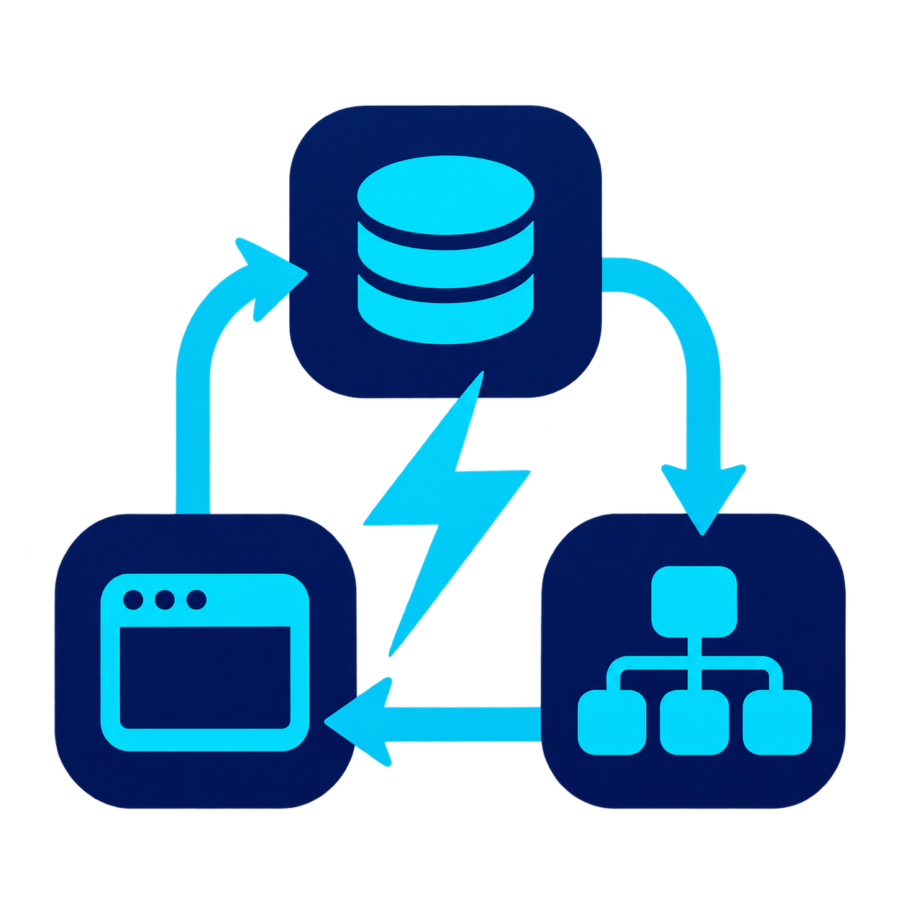

# ReactiveMvvm

A cross-platform feedback application built with ReactiveUI, reactive view models and source-generated properties. The same view model powers Avalonia, WPF, Windows Forms, .NET MAUI, Terminal.Gui and Blazor views on .NET 10 and .NET 11.

The screenshots below show the application's original implementations. The Xamarin.Forms sample has been replaced by .NET MAUI.

| <a href="https://github.com/AvaloniaUI/Avalonia">AvaloniaUI</a> | <a href="https://docs.microsoft.com/ru-ru/xamarin/xamarin-forms/">Xamarin.Forms</a> | <a href="https://docs.microsoft.com/ru-ru/windows/uwp/get-started/universal-application-platform-guide">Universal Windows Platform</a> |
| --------------- | --------- | -------------- |
|  |  |  | 

| <a href="https://github.com/dotnet/wpf">WPF</a> | <a href="https://github.com/dotnet/winforms">Windows Forms</a> | <a href="https://github.com/migueldeicaza/gui.cs">Terminal.Gui</a> |
| --------------- | --------- | -------------- |
|  |  |  | 

| ASP .NET Core via <a href="https://github.com/worldbeater/ReactiveMvvm/tree/main/src/reactivemvvm.blazor.server">Blazor</a> or <a href="https://github.com/worldbeater/ReactiveMvvm/tree/main/src/reactivemvvm.blazor.wasm">Blazor.Wasm</a> | 
| --------------- | 
|  | 

## Technologies

- ReactiveUI and System.Reactive for observable state, commands and view activation.
- ReactiveUI.SourceGenerators for reactive properties.
- Avalonia with the Fluent theme, WPF, Windows Forms, .NET MAUI, Terminal.Gui and Blazor for platform views.
- TUnit and Microsoft.Testing.Platform for deterministic tests and Cobertura coverage.

## Contribute

ReactiveMvvm is part of [ReactiveUI](https://github.com/reactiveui) and is released under the [MIT license](https://github.com/reactiveui/ReactiveMvvm/blob/main/LICENSE). We welcome contributions of every size, from bug reports and documentation to features and tests.

- **Questions:** ask in [GitHub Discussions](https://github.com/reactiveui/ReactiveUI/discussions).
- **Bugs and feature requests:** open a [GitHub issue](https://github.com/reactiveui/ReactiveMvvm/issues/new/choose).
- **Larger changes:** open an issue or discussion first, so we can agree on the approach before you start.
- **Contributor guide:** read [reactiveui.net/contribute](https://www.reactiveui.net/contribute/) for [building and testing](https://www.reactiveui.net/contribute/building-and-testing/) and [pull requests](https://www.reactiveui.net/contribute/pull-requests/).

### Coding standards

Every pull request must meet these standards. The build checks most of them.

- Follow the [ReactiveUI C# style guide](https://www.reactiveui.net/contribute/software-style-guide/code-style/).
- The repository's `.editorconfig` and the StyleSharp, PerformanceSharp and SecuritySharp analyzers run on every build. Fix each finding in the code. Do not suppress it or relax the `.editorconfig`.
- Add tests for every bug fix and new feature.
- Document public APIs with XML documentation comments.
- Write commit messages in the [Conventional Commits](https://www.reactiveui.net/contribute/software-style-guide/commit-message-convention/) format.
- Follow the [Code of Conduct](https://github.com/reactiveui/.github/blob/main/CODE_OF_CONDUCT.md).

### Support the project

- Sponsor the maintainers on GitHub Sponsors: [reactivemarbles](https://github.com/sponsors/reactivemarbles), [glennawatson](https://github.com/sponsors/glennawatson) and [chrispulman](https://github.com/sponsors/chrispulman).
- Ask your employer to support open source, for example with the [balanced employee IP agreement](https://github.com/github/balanced-employee-ip-agreement).

## Sponsors

[JetBrains](https://www.jetbrains.com/) gives ReactiveUI's maintainers licences for its tools through its
[open source support programme](https://www.jetbrains.com/community/opensource/).
[Anthropic](https://www.anthropic.com/) supports them with [Claude](https://claude.com/) through
[Claude for Open Source](https://claude.com/contact-sales/claude-for-oss).
[OpenAI](https://openai.com/) supports them with [Codex](https://openai.com/codex/) through
[Codex for Open Source](https://developers.openai.com/community/codex-for-oss).
[Snyk](https://snyk.io/) gives the maintainers access to security tools through its
[Secure Developer Program](https://snyk.io/open-source/).

See [our sponsors](https://www.reactiveui.net/sponsors/) for more information.
JetBrains, Claude, Anthropic, OpenAI and Codex names and logos are trademarks of their respective owners.
Snyk and the Snyk logo are trademarks of Snyk Ltd.
